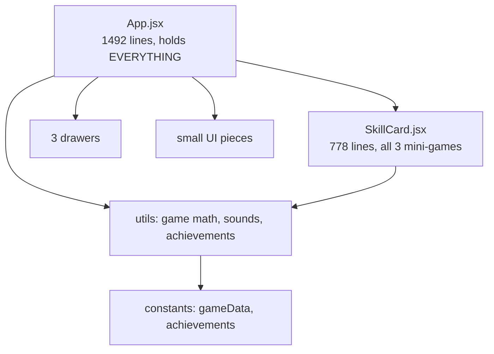

# Technical Debt Register

Baseline: commit `415bedb` (project as received), 2026-11-12.
Every refactoring PR references one item (example: "Fixes D01").
Tags per item: effort (hours / days / week+) and status (open / in progress / done).

## 1. Map

Kids RPG: React 19 + Vite, packaged for Windows with Electron (plain 1280x720 window, no IPC).

- State: all in App.jsx (31 useState, no context). Props passed by hand (up to 21).
- I/O called directly everywhere, no wrapper: localStorage (28 sites), `new Audio` (11),
  mic, `Math.random` (34), `setTimeout` (28). This is what blocks testing.
- Saves: one JSON blob per profile (`heroSkills_v23_p1/2/3`), rewritten on every hit.
- Critical flows to freeze with tests: save/load, combat/XP, achievements, mini-games, themes.

## 2. Baseline metrics

| What | Value |
|---|---|
| Test coverage | 0 % (after D08: gameUtils.js 80 % lines, gated at 80) |
| Code size | 6 938 lines / 24 files (App.jsx 1492, GlobalStyles 1302, SkillCard 778) |
| Complexity | worst 107 (SkillCard.jsx:65), 14 functions above 10 |
| Duplication | 2.5 % (6 clones, biggest 103 lines) |
| npm run lint | 28 errors, all from `._*` junk files |
| Repo | 243 MB assets, 374 `._*` files committed |

- Lines: `find src electron -name '*.js*' -not -name '._*' -exec wc -l {} +`
- Complexity: ESLint rule `complexity` (threshold 10), JSX enabled
- Duplication: `npx jscpd src electron --min-tokens 50`
- Coverage: `npm run test:coverage` (v8 provider, `include: ['src/**']`)

Re-measure after each phase.

### Measurement log

Dated, so every claim of progress can be checked against a commit.

| Date | Change | Coverage (lines) | Note |
|---|---|---|---|
| 2026-11-12 | baseline `415bedb` | 0 % | project as received |
| 2026-11-19 | D08 safety net | 19.3 % | game formulas under characterization tests |
| 2026-11-24 | i18n layer (Translation mission) | 51.6 % | jsdom component tests reach `App.jsx`, 0 % -> 30 % on that file |

## 3. Fix first (P1)

- **D01 · Game almost silent** · `soundManager.js:18` : looks in `sounds/ui/`, files are in
  `sounds/ui/ui/` (same for mob); errors hidden by `.catch(() => {})`. (hours, open)
- **D02 · Profile switch corrupts data** · `App.jsx:925` : stats never reloaded, autosave
  writes old player's stats into the new profile. (days, open)
- **D03 · Corrupted save = white screen** · `App.jsx:51` : JSON.parse without try/catch at
  startup, no error boundary. (hours, open)
- **D04 · Double effects in dev** · `App.jsx:569` : sounds/badges/timers fired from inside a
  state updater; StrictMode runs it twice. (week+, open)
- **D05 · Two god components** : App.jsx (one 361-line function) and SkillCard.jsx
  (complexity 107, 1100-char lines). Untestable. (week+, open)
- **D06 · No seams** : all I/O hit as globals; wrappers needed before testing. (days, open)
- **D07 · CI publishes a public release on every push** · `build-exe.yml:43`. (hours,
  done: workflow now runs on tags/manual only; it was in fact inert, `.github` sits
  in CodeWashGame/ and GitHub only reads workflows at the repo root)
- **D08 · No test/lint/coverage in CI**. (days, done: Vitest + 19 characterization
  tests on the game formulas, root ci.yml runs lint + build + tests + coverage gate)
- **D09 · 374 `._*` junk files** : cause all 28 lint errors, block lint as a gate. (hours,
  done: lint 28 errors -> 0)
- **D10 · No README / .gitignore**. (hours, done)

## 4. Fix soon (P2)

- **D11 · 3 of 4 themes visibly broken** · `gameData.jsx:189-208` : 4 missing images, spy
  background = minecraft.png. (hours, open)
- **D12 · Theme = wallpaper only** : empty mob lists, hardcoded colors everywhere, shuffled
  theme identities. (days, open)
- **D13 · Minecraft hardcoded in the domain** : mobs, badges, words, skill names; shown in
  every theme. Blocks the Themes mission. (week+, open)
- **D14 · XP math inconsistent** · `App.jsx:711` : multi-level gain reuses one threshold;
  UI vs engine off by one at level 20. (days, open)
- **D15 · Unreachable achievements** : perfectionist (stat never incremented), full_set
  (needs 8 badges, cap is 7), speed_demon (counts forever). (hours, open)
- **D16 · Timers never cleaned** : 21 of 28 setTimeout leak; Simon keeps playing after exit,
  mic restarts itself. (days, open)
- **D17 · Fragile slow saves** : ad-hoc migration, display data persisted, full write per
  hit, reset = page reload. (days, open)
- **D18 · Copy-paste x6** : letter-slot input x4, audio snippet x6, tooltips x3. (days, open)
- **D19 · Dead code** : 2 orphan files, 9 unused exports, ~330 lines dead CSS, inert
  tailwind.config.js. (hours, open)
- **D20 · 3 competing stylesheets** : 1302-line CSS string in JSX + index.css duplicates +
  inert Tailwind config. (days, open)
- **D21 · Mic feature likely dead in the exe** : Google cloud API without keys, no fallback;
  background noise costs HP. (week+, open)
- **D22 · Electron security** : no CSP, remote content, no nav guard, parental password in
  the bundle. (days, open)
- **D23 · Window too small** : fixed 720p, no scroll, content ~900+ px; battle panel off
  screen. (days, open)
- **D24 · Bug Report button is a stub** : "Whoa... That sucks...", no form, no close button.
  This is the Bug Reporting mission. (days, open)
- **D25 · Fragile build** : undocumented rolldown-vite alias, Windows-only target, 162 MB of
  .wav in the exe. The CI also ran Node 20 while the toolchain needs newer (fixed:
  workflows and `engines` now pin 24.15+, after jsdom workers failed to start on 20).
  (days, open)
- **D26 · Magic numbers** : boss cadence "20" x9 with 3 formulas, HP "10" x3, `#FFD700` x8.
  (days, open)
- **D33 · `format:check` exists but is not enforced** : Prettier and the
  `format:check` script are installed, yet no CI step runs them, so a badly
  formatted commit still merges. Demonstrated once already: the PR that added
  Prettier failed its own `format:check` on `vite.config.js` while the job was
  green. (hours, open)
- **D32 · Most UI strings are still inline English** : the settings drawer and
  the main-menu buttons are extracted; the mini-games (`SkillCard.jsx`), the
  achievement drawer, the cosmetics drawer and the modals are not. Blocks a
  complete Translation delivery. (days, open)

## 5. Later (P3)

- **D27 · Four product names** + stock Vite favicon. (hours, open)
- **D28 · No accessibility** : 2 aria-labels, no keyboard, mic-only reading. (week+, open)
- **D29 · Debug leftovers in UI** : 28 console.log, "LOGO PLACEHOLDER", "WIN". (hours, open)
- **D30 · Inconsistent rules** : wrong answers free in writing, Simon bonus discarded.
  (hours, open)
- **D31 · i18n layer has no plural rules** · `src/i18n/translator.js` : keys
  interpolate `{{vars}}` but cannot say "1 badge / 2 badges". Needs a `plural()`
  helper or `Intl.PluralRules` the first time a counted string is translated.
  Accepted knowingly, see `docs/adr/0001-i18n.md`. (hours, open)

## 6. Risk matrix

|  | Low likelihood | Medium | High |
|---|---|---|---|
| **High impact** | D21 | D02, D04, D13 | D01, D05, D06, D07, D08 |
| **Medium impact** | D17, D30 | D11, D12, D14, D16, D18, D22, D23, D24, D25, D26 | D03, D09, D10, D33 |
| **Low impact** | D19, D27, D31 | D20, D28, D29, D32 | D15 |

## 7. Attack plan

1. **Hygiene** (no behavior change): remove `._*` (D09), commit README/.gitignore (D10),
   stop release spam (D07).
2. **Safety net**: Vitest + characterization tests (math, then save/load, then combat),
   CI gates (D08), minimal seams (D06).
3. **Visible fixes under test**: D01, D03, D11, D15. Mid-term demo material.
4. **Hotspots**: D05, D04, D02, D16, D17. Re-measure after each PR.
5. **The 4 missions**: Bug Reporting (D24), Translation (D32), Themes (D11, D12, D13),
   Trivia (new game).
6. **Handover**: ADRs, runbook, changelog; this file maps the remaining debt.
